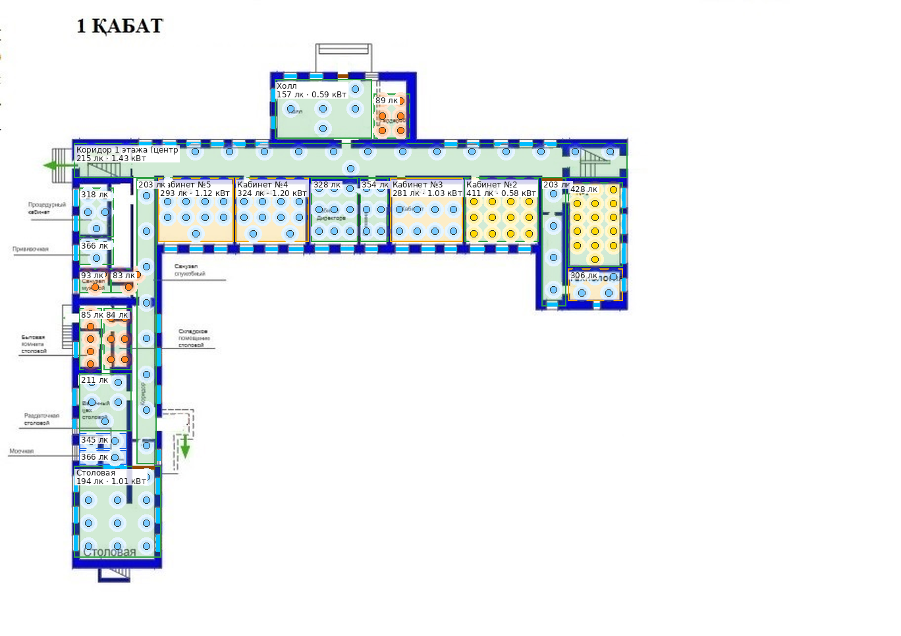

# 💡 ЭкоСвет — как уменьшить расход электроэнергии в школе

Веб-приложение на **Streamlit** для школьного энергоаудита освещения.
КГУ «Специализированная школа-лицей «Жас дарын», Павлодарская область.

> **Практическая ценность:** школьный энергоаудит, выявление источников нерационального потребления
> электроэнергии и разработка правил энергосбережения.



## ✨ Возможности

| Раздел | Что делает |
|---|---|
| 🗺️ **Карты школы** | 5 планов (1 и 2 этаж, здание Астана 127, спортзал 1 и 2 этаж), каждый выбирается отдельно. Контуры помещений окрашены по статусу освещённости, лампы — по технологии. |
| 🪟 **Окна и двери** | Распознаются автоматически по условным знакам плана (окно — светлый участок стены с серыми линиями, дверь — белый разрыв в синей стене). По окнам считаются площадь остекления, световой коэффициент, **КЕО**, дневная освещённость и экономия от дневного света. |
| ✏️ **Карандаш** (админ) | Клик по плану ставит лампу выбранного типа (помещение определяется автоматически), 🧽 ластик удаляет, ▭ — разметка нового помещения двумя кликами. |
| 📋 **Паспорт кабинета** | Площадь, высота, режим работы, окна, датчики; лампы: кол-во, Вт, кВт, лм; освещённость (лк) и % нормы; кВт·ч и ₸ за день/месяц/год; CO₂; класс энергоэффективности; рекомендации; Excel. |
| 🏫 **Паспорт школы** | Итоги по каждому плану и школе, графики, все помещения, Excel/CSV/JSON. |
| 💰 **Экономия** | 5 сценариев: LED, датчики движения, дневной свет, раннее выключение, комплекс — кВт·ч, ₸, CO₂, инвестиции, окупаемость. |
| 📊 **SWOT** | Автоматический SWOT из данных + пункты администрации. |
| 🤖 **ИИ-анализ** | По помещению, по плану, по всей школе. Встроенный экспертный движок + (опционально) Claude / OpenAI по API-ключу. |
| 💬 **Отзывы** | Зарегистрированные пользователи пишут администрации; админ отвечает и меняет статус. |
| ⚙️ **Админ** | Тариф, коэффициенты, каталог ламп, нормы, загрузка новых планов, пользователи и роли, резервная копия. |

**Роли:** редактирует только **администратор**. Любой желающий может **зарегистрироваться** и смотреть все данные
и оставлять отзывы.

## 🚀 Запуск локально

```bash
git clone https://github.com/<ваш-логин>/ecosvet.git
cd ecosvet
python -m venv .venv && source .venv/bin/activate   # Windows: .venv\Scripts\activate
pip install -r requirements.txt
cp .streamlit/secrets.toml.example .streamlit/secrets.toml   # задайте пароль администратора
streamlit run app.py
```

При первом запуске создаются база `data/ecosvet.db` с данными всех 5 планов и администратор
(`ADMIN_USERNAME` / `ADMIN_PASSWORD` из secrets; если не заданы — `admin` / `admin123`, **смените сразу**).

## ☁️ Деплой на Streamlit Community Cloud

1. Загрузите репозиторий на GitHub.
2. [share.streamlit.io](https://share.streamlit.io) → **New app** → репозиторий, файл `app.py`.
3. **Settings → Secrets**: вставьте содержимое `secrets.toml.example` со своим паролем (и при желании API-ключ).
4. ⚠️ На бесплатном хостинге файл базы может сброситься при перезапуске — регулярно скачивайте
   **резервную копию (JSON)** в «Администрирование» и восстанавливайте её при необходимости.

## 📐 Методика и формулы

- Освещённость (метод коэффициента использования): **E = Φ·U·MF / S**, где Φ — суммарный поток ламп (лм),
  S — площадь (м²), U ≈ 0,5, MF ≈ 0,8.
- Ламп до нормы: **N = ⌈E_норм·S / (Φ_лампы·U·MF)⌉**.
- Потребление: **кВт·ч = P(кВт) × ч/день × дни/мес × мес/год**; стоимость = кВт·ч × тариф.
- Естественный свет: Aок = ширина окон × высота окна; **КЕО = T·Aок·θ° / (Aпов·(1 − R²))** (формула BRE),
  Eест = КЕО/100 × Eнаруж; экономия = доля светлых часов × min(1, Eест/Eнорм). Параметры T, θ, R, Eнаруж
  настраиваются в «Администрирование».
- Класс энергоэффективности по удельной мощности на 100 лк: A ≤ 3; B ≤ 4,5; C ≤ 6; D ≤ 8; E > 8 Вт/м².

Это инженерная оценка. Для точных значений измерьте освещённость люксметром (или приложением-люксметром на смартфоне).

## ⚠️ Важно про начальные данные

Помещения и их контуры сняты с планов эвакуации. **Площади** (кроме здания Астана 127, где они подписаны на плане),
**количество и тип ламп, тариф и цены — ориентировочные.** Перед выводами проведите обход и внесите реальные данные:
маркировку ламп, количество, часы работы и действующий тариф энергоснабжающей организации.
Нормы освещённости сверьте с действующими санитарными правилами для объектов образования РК.

## 🔄 Обновление уже установленной программы

При запуске новой версии база обновляется сама: кабинеты переименовываются по номерам на новых планах
(№1–№21), у всех помещений распознаются окна и двери. Ваши лампы и правки сохраняются.

## 🗂️ Структура

```
app.py              — вход, регистрация, навигация
core/db.py          — SQLite, CRUD, резервная копия
core/auth.py        — пароли (PBKDF2), роли
core/calc.py        — расчёты освещённости, энергии, сценариев экономии
core/seed.py        — 5 планов, 77 помещений, каталог ламп, нормы
core/mapdraw.py     — отрисовка энергокарты
core/openings.py    — распознавание окон и дверей на плане
core/swot.py        — SWOT, рекомендации, правила энергосбережения
core/ai.py          — ИИ-анализ (встроенный + LLM)
core/export.py      — Excel/CSV
ui/*.py             — страницы
assets/maps/        — планы школы
tests/              — pytest
PROMPT.md           — супер-промпт, по которому создан проект
```

## 🧪 Тесты

```bash
pip install pytest && pytest -q
```

## 📜 Лицензия

MIT. Шрифт DejaVu Sans — свободная лицензия (Bitstream Vera / DejaVu).
